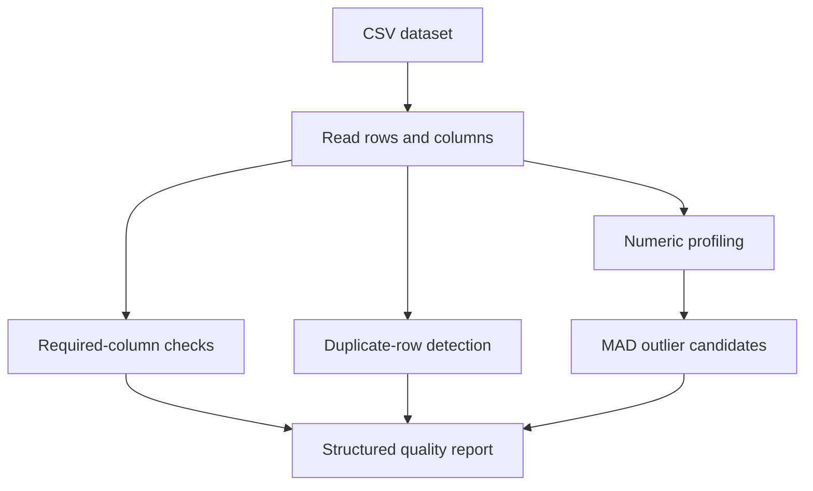

# AI Data Quality Monitor

A local CSV profiling utility for identifying common data-quality issues before a dataset reaches a dashboard, import job, or downstream analytics pipeline. The current implementation is deterministic Python—not an AI model or hosted monitoring service.

## Checks included

- Required-column presence and missing/blank cell counts.
- Exact duplicate-row detection.
- Numeric-column summaries when enough values can be parsed.
- Median and median-absolute-deviation (MAD) based outlier candidates.
- JSON-serializable output with issue records suitable for a CI or scheduled-job wrapper.

## Profiling flow



## Quick start

Requirements: Python 3.10+.

```bash
git clone https://github.com/HardikPaghdar/ai-data-quality-monitor.git
cd ai-data-quality-monitor
python -m venv .venv
source .venv/bin/activate
# Windows: .venv\Scripts\activate
```

## Run the sample

```bash
python - <<'PY'
from app import profile_csv
import json
report = profile_csv(
    "examples/customers.csv",
    ["customer_id", "region", "monthly_spend"]
)
print(json.dumps(report, indent=2))
PY
```

## Output fields

The report includes row count, discovered columns, missing-cell counts by required column, duplicate-row count, numeric summaries, and a list of issues. Outlier values are flagged as candidates for investigation—not deleted or corrected automatically.

## Tests

```bash
python -m unittest discover -s tests -v
```

GitHub Actions runs the automated test suite on pushes and pull requests.

## Limitations and production considerations

- This is a local CSV utility; it does not watch databases, schedule jobs, send alerts, or maintain historical quality trends.
- MAD-based outlier detection is conservative and skips classification when MAD is zero.
- Numeric parsing and thresholds are generic; domain-specific validation rules should be added for each dataset.
- Missing values and outliers are signals for review, not necessarily bad data.
- Add PII handling, access controls, dataset versioning, retention policies, and alert delivery before production use.

## Project structure

- `app.py` — CSV loading and deterministic profiling functions
- `examples/customers.csv` — synthetic sample data
- `tests/test_app.py` — unit tests
- `.github/workflows/ci.yml` — CI workflow

## Related projects

- [AI Invoice Processing Automation](https://github.com/HardikPaghdar/ai-invoice-processing-automation)
- [Natural Language to SQL Analytics Agent](https://github.com/HardikPaghdar/natural-language-to-sql-analytics-agent)
- [More projects on my portfolio](https://hardikpaghdar.netlify.app/)
